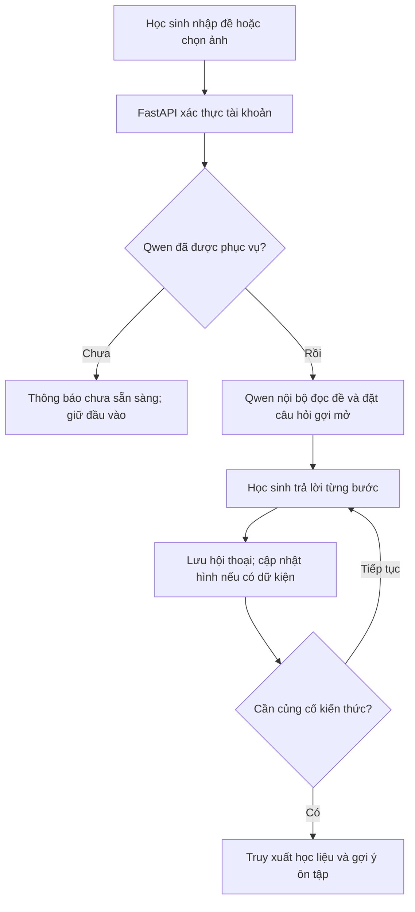
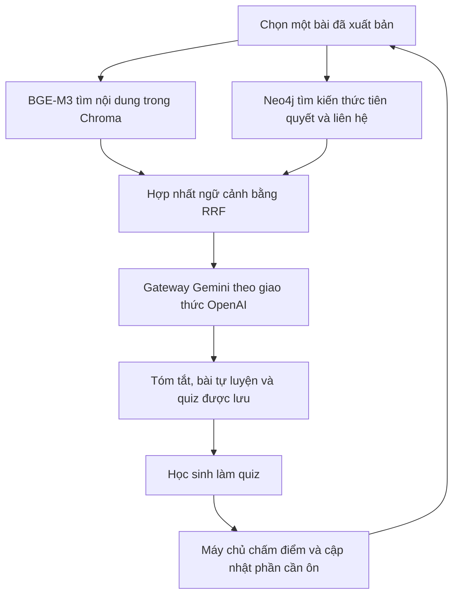
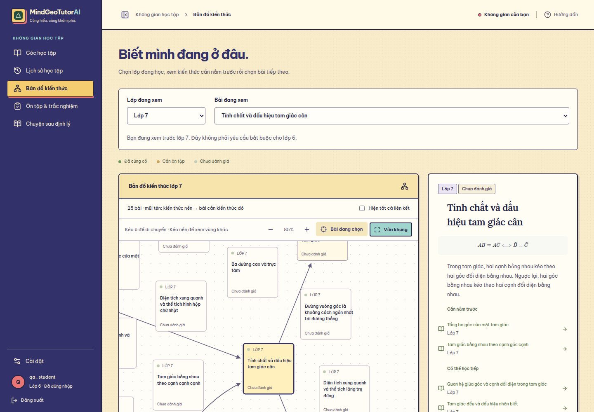
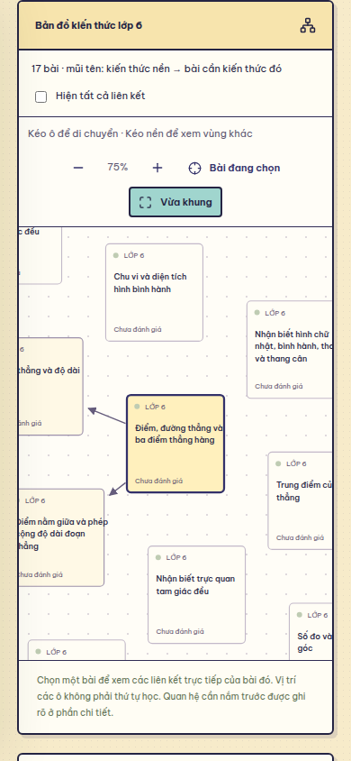

# Hướng dẫn sử dụng MindGeoTutorAI

Team DuyPy · Cập nhật 09/11/2026

Tài liệu dành cho học sinh, giáo viên và quản trị viên. Các tình huống thực hành nằm trong [Kịch bản sử dụng](KICH_BAN_SU_DUNG.md).

## 1. Hiện có thể sử dụng những gì?

| Chức năng | Tình trạng |
|---|---|
| Đăng ký/đăng nhập, hồ sơ và phân quyền | Dùng được |
| Tủ kiến thức, bản đồ theo lớp và quan hệ tiên quyết | Dùng được |
| Quiz biên soạn sẵn, chấm điểm, lưu kết quả và ghi nhận kiến thức cần ôn | Dùng được |
| Truy xuất Hybrid RAG, tạo tóm tắt/bài tập/quiz qua gateway Gemini | Đã kiểm thử dịch vụ thật; nội dung AI vẫn cần đối chiếu |
| Giáo viên quản lý học liệu, duyệt nội dung, quản lý quan hệ và bài viết | Dùng được |
| Agent tìm nguồn web và lập báo cáo | Đã kiểm thử dịch vụ thật; báo cáo không tự xuất bản vào kho |
| Gia sư Qwen nhận văn bản/ảnh và hướng dẫn giải toán | Chờ máy GPU và endpoint phục vụ checkpoint của tác giả |

Đã có checkpoint trên Hugging Face chưa đồng nghĩa đã có dịch vụ suy luận. Hiện gửi đề cho gia sư sẽ báo Qwen chưa cấu hình và giữ đầu vào để thử lại. Không dùng Gemini thay cho gia sư.

## 2. Đăng nhập và chọn lớp

1. Mở địa chỉ website do người vận hành cung cấp. Trên máy phát triển hiện tại: <http://localhost:5173>.
2. Chọn **Chưa có tài khoản? Đăng ký**, điền tên đăng nhập, tên hiển thị, lớp và mật khẩu.
3. Tài khoản đăng ký công khai là **học sinh**. Giáo viên/quản trị viên được người quản trị cấp quyền.
4. Vào **Cài đặt → Hồ sơ học tập**, kiểm tra lớp rồi bấm **Lưu thay đổi**.
5. Trên máy tính, bấm biểu tượng cạnh “Không gian học tập” để **Ẩn thanh bên** hoặc **Hiện thanh bên**. Lựa chọn được nhớ khi tải lại trang.
6. Trên điện thoại, bấm biểu tượng menu để mở thanh điều hướng; bấm dấu × hoặc vùng ngoài menu để đóng. Sidebar được thu gọn; trên màn hình thấp vẫn có thể cuộn menu nhưng không lộ thanh cuộn dài.

Với tài khoản giáo viên/quản trị viên, Cài đặt hiển thị **Thông tin tài khoản** và vai trò được cấp. Các tài khoản này không có ô Lớp đang học hoặc nút xuất/xóa dữ liệu học tập cá nhân; thanh bên ghi Giáo viên/Quản trị viên thay cho lớp. Ngày cập nhật học liệu hiển thị dạng **ngày/tháng/năm · giờ:phút**, theo giờ Việt Nam.

`localhost` trên điện thoại là chính điện thoại đó. Để dùng web từ điện thoại, cần địa chỉ web/LAN/HTTPS do người vận hành thiết lập; mở địa chỉ localhost của laptop trên điện thoại sẽ không tới được laptop.

## 3. Luồng tổng quát

### Luồng A — Học cùng gia sư Qwen



Đề bài, ảnh và lịch sử hội thoại chỉ gửi tới endpoint Qwen do người vận hành cấu hình. Gemini không tham gia trả lời chat này.

### Luồng B — Ôn tập và tạo bài/quiz từ kiến thức trong kho



Model sinh học liệu chỉ nhận ngữ cảnh toán học đã truy xuất; không nhận ảnh đề bài, đoạn chat hoặc thông tin định danh học sinh. Cấu trúc JSON hợp lệ không chứng minh mọi đáp án đúng về toán học.

## 4. Học sinh: đọc bản đồ đúng cách

1. Mở **Bản đồ kiến thức**.
2. Hệ thống mặc định chọn lớp trong hồ sơ của học sinh. Ví dụ lớp 6 chỉ hiện các bài lớp 6.
3. Ô **Lớp đang xem** cho phép đổi lớp hoặc chọn **Tất cả các lớp**. Mỗi ô vuông ghi rõ lớp của bài.
4. Các ô bố trí tự do theo liên kết và có thể kéo; vị trí trái/phải, trên/dưới không biểu thị thứ tự học. Dùng **Bài đang xem** để tìm nhanh bài và đưa ô đó vào giữa khung.
5. Bấm một bài: khung bên cạnh hiện **Cần nắm trước** và **Có thể học tiếp**, kèm lớp của từng bài.
6. Mũi tên có nghĩa **kiến thức nền → bài cần kiến thức đó**. Mặc định chỉ hiện liên kết trực tiếp của bài đang chọn; bật **Hiện tất cả liên kết** để xem rộng hơn.
7. Bấm một bài trong **Cần nắm trước** để chuyển tới đúng lớp/bài đó; bấm **Ôn kiến thức này** để mở nội dung.
8. Kéo một ô để đổi vị trí; kéo nền để di chuyển vùng nhìn. Dùng nút +/−, cuộn chuột hoặc chụm hai ngón tay trên điện thoại để thu phóng.
9. **Vừa khung** xem tổng thể; **Bài đang chọn** đưa bài về giữa với cỡ dễ đọc.
Khi có nhiều đường nối, tắt **Hiện tất cả liên kết** để tập trung vào bài đang học.

Học sinh lớp 6 không được yêu cầu học lớp 7 trước. Chọn lớp 7 bằng bộ lọc là xem trước có chủ đích; đây không phải điều kiện bắt buộc cho lớp 6. Lớp cao hơn không được gán làm tiên quyết bắt buộc của bài lớp thấp hơn.

Ảnh minh họa từ tài khoản kiểm thử: chủ động xem trước lớp 7 từ hồ sơ lớp 6; giao diện ghi rõ đây không phải yêu cầu bắt buộc cho lớp 6.



Giao diện điện thoại khi chọn lớp 6:



Ba trạng thái:

- **Chưa đánh giá:** chưa đủ kết quả để kết luận năng lực; không có nghĩa là học sinh không biết bài.
- **Cần ôn tập:** đã ghi nhận cần củng cố từ câu trả lời hoặc quiz.
- **Đã củng cố:** có kết quả làm bài phù hợp; không thay thế đánh giá của giáo viên.

## 5. Học sinh: đọc bài, làm quiz và xem kết quả

### Đọc bài

Vào **Ôn tập & trắc nghiệm → Tủ kiến thức**. Chọn lớp, chủ đề hoặc gõ tên bài. Danh sách được nhóm theo lớp; chọn bài để đọc phát biểu, công thức, điều kiện, ví dụ và lỗi thường gặp.

Nhãn **chờ giáo viên duyệt** là trạng thái thẩm định nội dung, khác với **Chưa đánh giá** năng lực của học sinh trên bản đồ.

Nội dung sinh có hỗ trợ Markdown (đậm, danh sách, bảng) và công thức LaTeX khi được đặt trong `$...$` hoặc `$$...$$`. Công thức cũ lưu dạng văn bản thường vẫn hiển thị dưới dạng văn bản; nội dung sinh mới được yêu cầu dùng dấu phân cách toán.

### Quiz biên soạn sẵn

1. Chọn tab **Trắc nghiệm chẩn đoán**.
2. Chọn bộ chủ đề hiện có, bấm **Bắt đầu 4 câu hỏi**.
3. Trả lời đủ các câu rồi bấm **Nộp bài**.
4. Xem điểm, lời giải thích và liên kết **Ôn kiến thức này** ở câu sai.
5. Mở **Kết quả của bạn** để xem kết quả đã lưu.

Quiz mẫu gắn với các chủ đề hình tương tác; không mặc định áp dụng mọi bộ quiz cho mọi lớp. Khi cần bài phù hợp một nội dung cụ thể, dùng luồng tạo học liệu bên dưới.

### Tạo bài tập/quiz từ kho kiến thức

1. Mở một bài trong Tủ kiến thức.
2. **Tìm kiến thức tiên quyết** để xem kết quả truy xuất.
3. **Tạo bài tập & quiz từ học liệu** để yêu cầu model bên ngoài tạo nội dung.
4. Đọc tóm tắt, tự giải bài trước khi mở gợi ý/đáp án đối chiếu.
5. Bấm **Làm quiz vừa tạo**; đáp án được giữ và chấm trên máy chủ.
6. Muốn làm tiếp sau đó, mở **Xem quiz AI đã lưu**.

Hạn mức ứng dụng hiện là **100 lượt sinh tóm tắt/bài tập/quiz mỗi ngày cho cả hệ thống**, tính cả lượt gửi lỗi sau khi đã giữ chỗ. Đây không phải quota thực của Gemini và không áp dụng cho Qwen, đọc bài, làm quiz đã lưu hay dựng đồ thị offline.

## 6. Chọn ảnh và chụp đề bài

| Thiết bị | Thao tác |
|---|---|
| Laptop/máy tính | **Tải ảnh lên** hoặc kéo thả ảnh. Nút Chụp ảnh được ẩn; không mở webcam. |
| Thiết bị di động cảm ứng | **Tải ảnh lên** hoặc **Chụp ảnh** để gợi ý mở camera sau, tùy trình duyệt/thiết bị. |

1. Chọn ảnh JPG/PNG/WebP, tối đa 10 MB.
2. Dùng **Xoay ảnh 90 độ** hoặc **Cắt vùng đề bài** nếu cần.
3. Bổ sung câu hỏi văn bản rồi gửi khi Qwen đã sẵn sàng.
4. Nếu camera không được hỗ trợ, chụp bằng ứng dụng camera rồi dùng **Tải ảnh lên**. Với ảnh HEIC không được nhận, chuyển sang JPG/PNG.

Ẩn/hiện nút camera dựa trên giao diện di động cảm ứng. Thu nhỏ cửa sổ desktop không làm xuất hiện nút này. Việc chọn/cắt ảnh không đồng nghĩa Qwen đã phân tích ảnh.

## 7. Giáo viên: quản lý và duyệt học liệu

### Tìm kiếm, phân trang và mở trình sửa

Kho học liệu mặc định hiển thị 10 dòng/trang; dùng **Số dòng** để chọn 10, 20 hoặc 50, **Trang trước / Trang sau** hoặc chọn số trang. Bảng tải riêng từng trang từ máy chủ. Tìm kiếm và bộ lọc áp dụng toàn bộ kho; đổi điều kiện tìm sẽ quay về trang 1.

Hai bộ lọc độc lập:

- **Trạng thái xuất bản**: Đã xuất bản / Bản nháp, cho biết học sinh có được xem bài hay không.
- **Duyệt nội dung**: Nội dung đã duyệt / Nội dung chưa duyệt, cho biết giáo viên đã kiểm tra bài hay chưa.

Có thể kết hợp cả hai, ví dụ Đã xuất bản + Nội dung chưa duyệt. Bài không có ghi nhận duyệt được tính là chưa duyệt.

Bấm biểu tượng **bút chì** ở một dòng: hệ thống tải chi tiết bài, cuộn tới trình sửa và đặt con trỏ ở tên học liệu. Tên và sơ đồ quan hệ vẫn có trong danh mục chung; dữ liệu corpus mở rộng chỉ tải khi đọc bài chi tiết.

### Biên soạn

1. Mở **Kho học liệu → Thêm học liệu**.
2. Điền tên, nội dung, lớp, chủ đề, nguồn và công thức nếu có. Bài không gắn với ba hình tương tác chọn **Kiến thức hình học**.
3. Lưu **Bản nháp** khi chưa hoàn tất; chọn **Đã xuất bản** để học sinh đọc được.
4. Đọc và đối chiếu nguồn rồi dùng nút có dấu kiểm **Duyệt nội dung …** để ghi nhận việc duyệt.
5. Chỉnh sửa nội dung đã duyệt sẽ đưa nội dung về trạng thái cần duyệt lại.
6. Sau sửa nội dung/quan hệ, bấm **Thử đồng bộ chỉ mục** để cập nhật Neo4j/Chroma.

Xuất bản là cho phép sử dụng trong ứng dụng, không đồng nghĩa đã được thẩm định. Nút duyệt nội dung không duyệt thay mọi quan hệ mà LLM tự trích xuất. Các phần bổ sung của corpus như ví dụ và ý tưởng lý giải hiện được quản lý từ nguồn Markdown; trình sửa bài trên web chủ yếu chỉnh phát biểu, công thức, lưu ý và nguồn.

### Quan hệ tiên quyết

Trong tab **Quan hệ tiên quyết**, chọn bài nền làm nguồn và bài cần nền làm đích. Hệ thống từ chối cạnh trùng, chu kỳ và quan hệ từ lớp cao xuống lớp thấp. Không liên kết hai bài chỉ vì chúng đang đứng cạnh nhau trên hình.

### Đồ thị model trích xuất

Chỉ giáo viên/quản trị viên xem phần này trong **Kho học liệu**, sau khi chọn bài. Học sinh không có nút đồ thị trích xuất hoặc tên công nghệ truy xuất trên màn hình ôn tập. Bấm **Xem đồ thị model trích xuất** và mở **Bằng chứng của … quan hệ**. Đây là đồ thị tham khảo được tách khỏi DAG tiên quyết của giáo viên. Khi nội dung nguồn đã thay đổi, bằng chứng cũ bị ẩn và yêu cầu trích xuất lại; không dùng biểu đồ cũ làm thông tin mới.

### Nghiên cứu nguồn và bài viết

- Trong Kho học liệu, phần **Công cụ chuẩn bị bài dạy** giúp giáo viên rà soát kiến thức nền, tạo bài tập/quiz và tìm nguồn tham khảo. Chọn học liệu rồi bấm **Tìm nguồn web & lập báo cáo**. Đọc báo cáo và nguồn, tải Markdown khi cần. Báo cáo được lưu nhưng chưa tự trở thành bài đã xuất bản.
- Vào **Biên tập câu chuyện** để viết bài, thêm nguồn, xem trước, lưu nháp hoặc xuất bản. Bản nháp giữ được các dòng nguồn chưa điền đủ; khi xuất bản, từng nguồn phải có tên, URL hợp lệ và phạm vi đối chiếu.
- Nếu lưu nháp lỗi, đọc khung **Chưa thể lưu bản nháp**. Mỗi lỗi ghi rõ trường hoặc số thứ tự nguồn; bấm thông báo để đến ô cần sửa. Nội dung đang soạn vẫn được giữ, chỉ báo đã lưu khi máy chủ xác nhận. URL không rỗng phải dùng http/https hợp lệ.
- **Thống kê học tập** hiển thị số liệu tổng hợp và các khái niệm đang cần củng cố. Tài khoản giáo viên không mặc định xem lịch sử/ảnh riêng của học sinh khác.

## 8. Quản trị viên

Mở **Mô hình & hệ thống**:

1. **Kiểm tra kết nối** để kiểm tra trực tiếp dịch vụ; **Đã khai báo cấu hình** chỉ có nghĩa đã điền biến cấu hình.
2. Quản lý vai trò/trạng thái tài khoản. Tài khoản đổi vai trò cần đăng nhập lại.
3. Giữ hoặc chỉnh **Hạn mức mỗi ngày** cho sinh học liệu; thay đổi ở đây không làm thay quota nhà cung cấp.
4. Đăng ký checkpoint và metrics sau khi đã huấn luyện/đánh giá ở môi trường phù hợp. Trang này không tự chạy LoRA/KD/GRPO.

Không nhập khóa Gemini/Qwen/Neo4j vào frontend hoặc gửi khóa trong ảnh chụp màn hình. Cấu hình dịch vụ đặt ở `.env` backend và cần khởi động lại backend sau khi thay.

## 9. Khi gặp thông báo lỗi

| Thông báo/tình huống | Cách xử lý |
|---|---|
| Qwen chưa cấu hình | Tiếp tục dùng tủ kiến thức/quiz; người vận hành triển khai checkpoint theo [hướng dẫn Qwen](QWEN_DEPLOYMENT.md). Không điền khóa Gemini vào QWEN_API_KEY để thay thế. |
| Chỉ mục đã cũ | Giáo viên đồng bộ chỉ mục; nếu là đồ thị LLM thì chạy trích xuất lại theo nguồn mới. |
| Hết hạn mức sinh học liệu | Đọc bài/làm quiz đã lưu; quản trị kiểm tra hạn mức ứng dụng. Không coi đây mặc nhiên là hết quota Gemini. |
| Không kết nối máy chủ | Người vận hành kiểm tra frontend, Django và FastAPI đang chạy. |
| Không có quyền | Đăng nhập đúng tài khoản; quản trị cấp vai trò nếu phù hợp. Không chọn vai trò bằng dữ liệu gửi từ trình duyệt. |
| Đăng nhập lại sau đổi vai trò | Token cũ bị thu hồi; đăng nhập lại để nhận quyền mới. |
| Ảnh không hợp lệ | Chọn đúng định dạng/dung lượng; thử ảnh khác hoặc chuyển sang JPG/PNG. |
| Không có quan hệ tiên quyết | Kho chưa ghi nhận quan hệ cho bài; không suy luận rằng phải học tất cả ô nằm phía trên. |

## 10. Chạy trên máy phát triển

Người dùng website không cần chạy các lệnh dưới đây nếu người vận hành đã mở dịch vụ.

```bash
# Terminal backend
cd /home/duypy/Documents/MySource/backend_solve_math_web
.venv/bin/python scripts/run_dev.py
```

```bash
# Terminal frontend
cd /home/duypy/Documents/MySource/solve_math_vlm/frontend
npm run dev
```

Khởi tạo quản trị lần đầu dùng `manage.py createsuperuser`. Cấp quyền cho tài khoản đã đăng ký bằng `manage.py set_role TEN_DANG_NHAP educator` hoặc `admin`. Không có mật khẩu mặc định được phát chung trong tài liệu này.

Các lệnh import/đồng bộ/trích xuất đồ thị nằm trong [hướng dẫn offline](../knowledge/OFFLINE_BUILD.md). Lệnh trích xuất có giới hạn theo lần chạy, không trừ hạn mức sinh bài/quiz hằng ngày.

### Khi lập báo cáo báo lỗi gateway

Với cấu hình gateway 9router đang dùng trên máy phát triển, cần chạy 9router trước khi gọi model. Lệnh đã xác nhận trên máy này:

```bash
9router --host 127.0.0.1 --no-browser --skip-update
```

Gateway lắng nghe ở cổng 20128. Nếu dịch vụ chưa chạy, ứng dụng báo không kết nối được gateway model sinh báo cáo; đây là lỗi kết nối model, khác với lỗi kho tri thức hoặc dịch vụ tìm kiếm Tavily.
